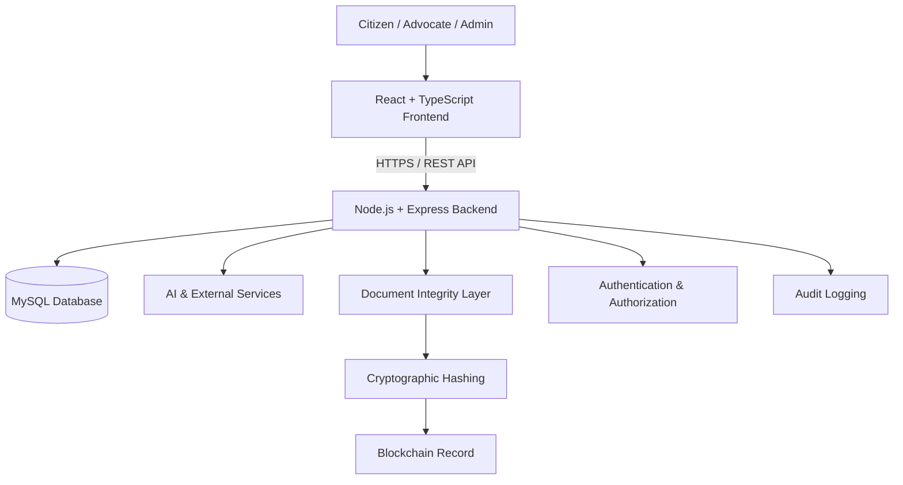

<div align="center">

# ⚖️ Nyaya AI

### Legal assistance. Secure workflows. Verifiable documents.

**An AI-powered legal-tech platform designed to make legal information and digital legal workflows more accessible, connected, and secure.**

[](https://nyayaai.online)
[](https://react.dev/)
[](https://nodejs.org/)
[](https://www.mysql.com/)

<br/>

**AI × LegalTech × Cybersecurity × Blockchain**

</div>

---

## 🚀 The idea

Legal information, advocate discovery, case coordination, and document handling are often spread across disconnected processes. **Nyaya AI brings these workflows together in one platform.**

It combines an AI legal assistant with citizen–advocate workflows, secure document management, document-integrity verification, and administrative oversight.

> **Our goal:** Build a practical legal-tech ecosystem where useful AI capabilities are supported by secure engineering and transparent document workflows.

---

## ✨ What can you do with Nyaya AI?

<table>
<tr>
<td width="50%" valign="top">

### 🤖 AI Legal Assistant
- Ask legal questions through a conversational interface
- Get AI-assisted legal information and guidance
- Work with document-related queries
- Use speech-to-text interaction support

</td>
<td width="50%" valign="top">

### 👨‍⚖️ Advocate Discovery
- Search for advocates
- Filter by district/location and practice area
- Explore advocate profiles and professional information
- Access consultation workflows

</td>
</tr>
<tr>
<td width="50%" valign="top">

### 📁 Case & Document Management
- Create and manage legal cases
- Associate documents with cases
- Store case-related information
- Track document activity and access

</td>
<td width="50%" valign="top">

### 📅 Consultations & Meetings
- Request consultations
- Manage appointments and meetings
- Support citizen–advocate interactions
- Validate participation in consultation workflows

</td>
</tr>
<tr>
<td width="50%" valign="top">

### ⛓️ Document Integrity Verification
- Generate SHA-256 document hashes
- Register or compare document-integrity values
- Check whether a registered document has changed
- Return clear verification states

</td>
<td width="50%" valign="top">

### 🛡️ Security & Audit Trail
- JWT-based authentication
- Secure, HttpOnly cookie handling
- CSRF protection and rate limiting
- Role-based authorization and activity logs

</td>
</tr>
</table>

---

## 🔐 What makes the document workflow different?

A legal document is more than a file. Its integrity and activity history matter.

Nyaya AI uses **cryptographic hashing and blockchain-based integrity records** to help detect changes to registered documents.

### How verification works

```text
       Original legal document
                 │
                 ▼
          Generate SHA-256
                 │
                 ▼
       Register integrity hash
                 │
                 ▼
       Blockchain-based record
                 │
        Later verification
                 │
                 ▼
      Hash comparison and result
```

### Verification outcomes

| Status | Meaning |
|---|---|
| `verified` | The document matches its registered integrity value |
| `tampered` | The current document does not match the registered value |
| `not_registered` | No integrity record was found |
| `blockchain_unavailable` | The blockchain verification service is unavailable |

**Important:** The document itself is not stored directly on the blockchain as part of this integrity workflow. Blockchain anchoring helps detect changes; it does not, by itself, establish legal validity, ownership, authorship, or a legally valid digital signature.

---

## 🛡️ Security is part of the architecture

Nyaya AI applies multiple layers of protection across authentication, API access, and document workflows.

| Security layer | Implementation |
|---|---|
| Authentication | JWT-based access and refresh tokens |
| Password protection | bcrypt password hashing |
| Cookie security | HttpOnly cookies and secure cookie configuration |
| CSRF defense | CSRF protection for protected requests |
| API abuse protection | Rate limiting on authentication-related APIs |
| HTTP headers | Helmet security middleware |
| Authorization | Protected routes and role-based access |
| Auditability | Document-related activity logging |
| Secret management | Environment variables for credentials and API keys |

### Role-based access

| Role | Purpose |
|---|---|
| `citizen` | Uses legal information and citizen workflows |
| `lawyer` | Uses advocate and consultation workflows |
| `admin` | Uses administrative management features |

Public registration does not allow users to assign themselves the `admin` role.

---

## 🧑‍💼 Administrative portal

The platform includes a dedicated admin portal for administrative oversight.

- **User administration:** overview, profile, documents, activity, security, and audit trail.
- **Advocate administration:** professional profile, documents, consultations, activity, security, and audit trail.
- **Scoped audit history:** administrators can inspect audit information associated with an individual user or advocate.
- **Protected access:** administrative pages and APIs require administrator authentication and authorization.

---

## 🧱 System architecture



### Deployment architecture

| Component | Platform |
|---|---|
| Frontend | Vercel |
| Backend | Render |
| Database | Railway — MySQL |
| Production domain | [nyayaai.online](https://nyayaai.online) |

---

## 🧰 Technology stack

<div align="center">

| Layer | Technologies |
|---|---|
| **Frontend** | React, TypeScript, Vite, Tailwind CSS, React Router |
| **3D / Visuals** | Three.js, React Three Fiber |
| **Backend** | Node.js, Express.js |
| **Database** | MySQL |
| **Authentication & Security** | JWT, bcrypt, Helmet, CSRF protection, rate limiting |
| **AI & Integrations** | External AI, speech-to-text, email, and authentication services |
| **Document integrity** | SHA-256 hashing, blockchain-based integrity records |
| **Deployment** | Vercel, Render, Railway |

</div>

---

## 🗂️ Project structure

```text
nyaya-ai/
├── backend/
│   ├── database/
│   ├── middleware/
│   ├── routes/
│   ├── services/
│   ├── utils/
│   └── server.js
│
├── src/
│   ├── components/
│   ├── context/
│   ├── lib/
│   └── pages/
│       ├── admin/
│       ├── advocate/
│       └── ...
│
├── public/
├── package.json
├── vite.config.ts
├── tsconfig.json
└── README.md
```

---

## ⚡ Run locally

### Prerequisites

- Node.js and npm
- MySQL
- Git

### 1. Clone the repository

```bash
git clone <YOUR_REPOSITORY_URL>
cd nyaya-ai
```

### 2. Install dependencies

```bash
npm install
```

If dependency resolution requires it:

```bash
npm install --legacy-peer-deps
```

### 3. Configure environment variables

Create the environment files required by your local setup. The frontend uses:

```env
VITE_API_URL=
```

Backend configuration may include:

```env
DB_HOST=
DB_USER=
DB_PASSWORD=
DB_NAME=

JWT_SECRET=

GOOGLE_CLIENT_ID=
GOOGLE_CLIENT_SECRET=

RESEND_API_KEY=
GROQ_API_KEY=
SARVAM_API_KEY=
```

Add any other service variables required by the integrations enabled in your environment. **Never commit real credentials, API keys, or `.env` files.**

### 4. Start the frontend

```bash
npm run dev
```

### 5. Create a production build

```bash
npm run build
```

> The backend and MySQL database must also be configured and running for full-stack functionality. Use the repository's backend setup and database instructions for your environment.

---

## 🔌 API overview

The backend exposes REST API modules including:

```text
/api/auth
/api/admin
/api/documents
/api/cases
/api/meetings
/api/appointments
/api/advocates
```

Example document-integrity endpoint:

```http
POST /api/documents/:id/blockchain/verify
```

Administrative endpoints include:

```http
GET /api/admin/me
GET /api/admin/users
GET /api/admin/advocates
GET /api/admin/users/:userId
GET /api/admin/users/:userId/documents
GET /api/admin/users/:userId/audit
GET /api/admin/advocates/:advocateId
GET /api/admin/advocates/:advocateId/audit
```

Protected endpoints require the appropriate authentication and authorization.

---

## 🧭 Try the platform

- **Live platform:** [https://nyayaai.online](https://nyayaai.online)
- **Admin login:** [https://nyayaai.online/adminlogin](https://nyayaai.online/adminlogin)

The admin dashboard is protected and requires authorized administrator access.

---

## 🔭 Engineering focus

Nyaya AI is an evolving project. Ongoing engineering priorities include:

- Expanding automated tests for authentication, authorization, and document workflows
- Improving API security and role-based access controls
- Strengthening auditability and production logging
- Improving maintainability and documentation
- Validating security-sensitive workflows through automated and manual testing

---

## ⚖️ Responsible use

Nyaya AI provides AI-assisted legal information and digital legal workflows. AI-generated responses may be inaccurate or incomplete and are **not a substitute for advice from a qualified advocate or legal professional**.

Users should independently verify important legal information and consult a qualified professional when needed. Blockchain-based document verification is an integrity-checking mechanism and does not, by itself, certify a document's legal validity.

---

## 🤝 Contributing

Contributions and suggestions are welcome.

Before submitting changes:

1. Review the existing implementation and architecture.
2. Keep changes focused and explain their purpose.
3. Preserve authentication, authorization, and document-access controls.
4. Never include credentials or private user data.
5. Test the affected functionality.
6. Update documentation when behavior changes.

---

## 📜 License

License information will be added according to the project's final distribution and ownership requirements.

---

<div align="center">

### ⚖️ Nyaya AI

**Making legal workflows more accessible, connected, and secure.**

[🌐 Visit Nyaya AI](https://nyayaai.online)

*Built with AI, secure software engineering, and a focus on document integrity.*

</div>
